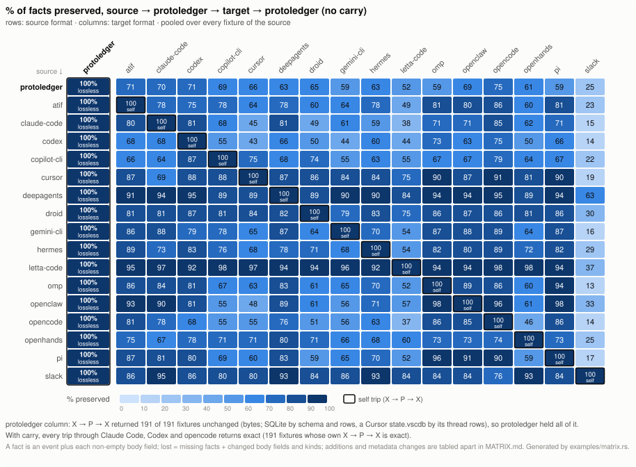

# Transfer matrix

Generated by `cargo run --release --example matrix -- --out docs/` (from `examples/matrix.rs`) over the 191 fixtures in `fixtures/`. Do not edit by hand.



## How to read it

Each row is a source format X, each column a target format Y. A cell is the share of X's facts that survive X → protoledger → Y → protoledger **without carry**, pooled over every fixture of X: 1 − Σ lost / Σ facts. A fact is an event (1) plus each of its non-empty body fields, the weighting `Diff::missing_facts` uses; harness-only `native` records are not counted. *Lost* counts the same things the fact total does: the facts of missing events (`Diff::missing_facts`), each changed body field of a matched event (`Diff::changed` `<kind>.body.<field>`) and each event whose kind changed (`<kind>.kind`), so it never exceeds the facts. Two things are reported beside the %, never in it: what the target **added** (`Diff::extra`: events, or agents, the source did not have), and **metadata changed** (event-level `ts`, `group`, `turn`, `audience`, `meta`, ordering and branch changes, plus agent header fields from `Diff::header`, links included), each in its own table below. A store container ledger, the one an opencode database keeps its session-less rows in or a Slack export's workspace ledger, holds no conversation: a target that cannot hold links loses the `member-of` links that tie the sessions or channels to it, and that is counted under metadata changed, not in the %. The **protoledger column** is the import itself: a cell there reads *lossless* when every fixture of X came home from X → protoledger → X with its native data unchanged, so protoledger held everything X had. The **diagonal** is that same self trip. Without carry a trip through Y keeps only what Y can express; **with carry**, a Claude Code, Codex or opencode export stows the protoledger events in a field the harness tolerates, and the last table shows how often X → P → Y → P → X then returned the source exactly.

## Lossless into protoledger

**191 of 191 fixtures, across all 17 formats, return unchanged from X → protoledger → X.** The evidence for each format is that self trip: `export_X(import_X(F))` compared with the fixture's own files. A file that is text or JSON must match **byte for byte**. An SQLite store cannot be reproduced byte for byte (page layout, freelist, FTS blocks), so it is compared by **schema and rows**: every object in `sqlite_master` the same (SQLite's own tables and automatic indexes included), the header values an application reads back (`application_id`, `user_version`, the text encoding) the same, and every row of every table present in the export with identical values (text and blobs compared as bytes), with no extra row in any table; the shadow tables SQLite keeps for a virtual table's index are not compared, the virtual table's own rows are; a Cursor `state.vscdb` is compared by its rows alone (see *Cursor's scope* below). Since protoledger is the only thing between the import and the export, whatever came back was in protoledger.

| source format | fixtures | byte-exact | row-identical (SQLite) | not exact | lossless into protoledger |
|---|---:|---:|---:|---:|---|
| `protoledger` | 4 | 4 | 0 | 0 | yes (4/4) |
| `atif` | 24 | 24 | 0 | 0 | yes (24/24) |
| `claude-code` | 27 | 27 | 0 | 0 | yes (27/27) |
| `codex` | 19 | 19 | 0 | 0 | yes (19/19) |
| `copilot-cli` | 10 | 10 | 0 | 0 | yes (10/10) |
| `cursor` | 18 | 15 | 3 | 0 | yes (18/18) |
| `deepagents` | 6 | 0 | 6 | 0 | yes (6/6) |
| `droid` | 8 | 8 | 0 | 0 | yes (8/8) |
| `gemini-cli` | 10 | 10 | 0 | 0 | yes (10/10) |
| `hermes` | 4 | 2 | 2 | 0 | yes (4/4) |
| `letta-code` | 9 | 9 | 0 | 0 | yes (9/9) |
| `omp` | 4 | 4 | 0 | 0 | yes (4/4) |
| `openclaw` | 9 | 7 | 2 | 0 | yes (9/9) |
| `opencode` | 17 | 11 | 6 | 0 | yes (17/17) |
| `openhands` | 9 | 9 | 0 | 0 | yes (9/9) |
| `pi` | 6 | 6 | 0 | 0 | yes (6/6) |
| `slack` | 7 | 7 | 0 | 0 | yes (7/7) |

**Cursor's scope.** A Cursor IDE `state.vscdb` is the whole IDE's state store, not a thread file. The cursor importer's scope is the threads in it: each composer, its bubbles and every other `cursorDiskKV` row whose key names the composer, each with its key, its value bytes and its storage class. A `cursorDiskKV` row tied to no thread is counted as `unlinked-row-skipped`, and every row of any other table (`ItemTable` and the rest of the IDE's own state) as `ide-state-skipped`; neither is carried or written back (`docs/formats/cursor.md`). So for cursor, *unchanged* means: every row of the fixture comes back with the same key, the same value bytes and the same storage class, and no extra row appears in any table, a table only the export declares included. A fixture holding rows outside the threads would not come back that way and would be listed as not exact. The export writes a new `state.vscdb` that declares its tables as Cursor does, so the table declarations are not part of the comparison; where they differ from the fixture's, they are listed here:

- `cursor/ide-agentsview-composers`: 7/7 rows identical, 0 extra; export declares index `sqlite_autoindex_ItemTable_1` (created by SQLite, no SQL); export declares table `ItemTable` `CREATE TABLE ItemTable (key TEXT UNIQUE ON CONFLICT REPLACE, value BLOB)`
- `cursor/ide-cursor-history-v016`: 8/8 rows identical, 0 extra; source declares table `cursorDiskKV` `CREATE TABLE cursorDiskKV (key TEXT PRIMARY KEY NOT NULL, value TEXT)`; export declares index `sqlite_autoindex_ItemTable_1` (created by SQLite, no SQL); export declares table `ItemTable` `CREATE TABLE ItemTable (key TEXT UNIQUE ON CONFLICT REPLACE, value BLOB)`; export declares table `cursorDiskKV` `CREATE TABLE cursorDiskKV (key TEXT UNIQUE ON CONFLICT REPLACE, value BLOB)`

## % of facts preserved without carry

Rows: source. Columns: target. *self* marks the diagonal. A cell with errors is computed over the fixtures that ran and says how many did not.

| source ↓ · target → | fixtures | protoledger | atif | claude-code | codex | copilot-cli | cursor | deepagents | droid | gemini-cli | hermes | letta-code | omp | openclaw | opencode | openhands | pi | slack |
|---|---:|---:|---:|---:|---:|---:|---:|---:|---:|---:|---:|---:|---:|---:|---:|---:|---:|---:|
| **protoledger** | 4 | 100.0 *self* | 72.0 | 70.2 | 72.0 | 69.6 | 66.4 | 63.3 | 65.1 | 59.2 | 63.3 | 52.2 | 59.9 | 69.2 | 75.4 | 61.6 | 59.9 | 25.6 |
| **atif** | 24 | 100.0 | 100.0 *self* | 78.1 | 75.4 | 78.1 | 64.4 | 78.1 | 60.7 | 64.3 | 78.5 | 49.7 | 82.0 | 80.2 | 86.0 | 60.3 | 81.9 | 23.2 |
| **claude-code** | 27 | 100.0 | 80.7 | 100.0 *self* | 81.8 | 68.2 | 45.8 | 81.8 | 49.1 | 61.3 | 59.6 | 38.1 | 71.5 | 71.6 | 85.8 | 62.7 | 71.7 | 15.4 |
| **codex** | 19 | 100.0 | 68.2 | 68.4 | 100.0 *self* | 55.7 | 43.3 | 66.8 | 50.3 | 44.2 | 60.9 | 44.2 | 73.5 | 63.0 | 75.4 | 50.7 | 66.4 | 14.6 |
| **copilot-cli** | 10 | 100.0 | 66.7 | 64.9 | 87.3 | 100.0 *self* | 75.2 | 68.3 | 74.2 | 55.2 | 63.9 | 55.2 | 67.1 | 67.0 | 79.4 | 64.4 | 67.2 | 22.6 |
| **cursor** | 18 | 100.0 | 87.4 | 69.9 | 88.0 | 88.6 | 100.0 *self* | 87.9 | 86.4 | 84.3 | 84.0 | 75.9 | 90.1 | 87.8 | 91.5 | 81.9 | 90.1 | 19.9 |
| **deepagents** | 6 | 100.0 | 91.3 | 95.0 | 95.8 | 89.4 | 89.9 | 100.0 *self* | 89.1 | 90.5 | 90.8 | 84.0 | 94.1 | 94.1 | 95.8 | 89.1 | 94.1 | 63.0 |
| **droid** | 8 | 100.0 | 81.8 | 81.8 | 87.0 | 81.0 | 84.1 | 82.9 | 100.0 *self* | 79.8 | 83.9 | 75.3 | 86.6 | 87.1 | 86.8 | 81.8 | 86.6 | 30.1 |
| **gemini-cli** | 10 | 100.0 | 86.9 | 88.6 | 79.7 | 78.5 | 65.3 | 87.0 | 65.0 | 100.0 *self* | 70.2 | 54.3 | 87.7 | 88.4 | 89.1 | 64.6 | 87.7 | 16.0 |
| **hermes** | 4 | 100.0 | 89.5 | 73.5 | 83.3 | 76.5 | 68.5 | 78.4 | 71.6 | 68.5 | 100.0 *self* | 54.9 | 82.1 | 80.9 | 89.5 | 72.2 | 82.1 | 29.6 |
| **letta-code** | 9 | 100.0 | 95.1 | 97.3 | 92.0 | 98.7 | 97.3 | 94.7 | 94.7 | 96.5 | 92.0 | 100.0 *self* | 94.7 | 94.7 | 98.7 | 98.7 | 94.7 | 37.2 |
| **omp** | 4 | 100.0 | 86.0 | 84.3 | 81.4 | 67.9 | 63.6 | 83.3 | 61.4 | 65.5 | 70.6 | 52.1 | 100.0 *self* | 89.2 | 87.0 | 60.3 | 94.4 | 13.4 |
| **openclaw** | 9 | 100.0 | 93.0 | 90.8 | 81.0 | 55.7 | 48.1 | 89.5 | 61.4 | 56.8 | 71.1 | 57.0 | 98.6 | 100.0 *self* | 96.9 | 61.4 | 98.6 | 33.4 |
| **opencode** | 17 | 100.0 | 81.2 | 78.2 | 68.8 | 55.4 | 55.7 | 76.5 | 51.9 | 56.8 | 63.7 | 37.8 | 86.8 | 85.0 | 100.0 *self* | 46.2 | 86.8 | 14.2 |
| **openhands** | 9 | 100.0 | 75.4 | 67.2 | 78.0 | 71.7 | 71.7 | 80.4 | 71.7 | 66.7 | 68.5 | 60.3 | 73.0 | 73.5 | 74.3 | 100.0 *self* | 73.8 | 25.4 |
| **pi** | 6 | 100.0 | 87.3 | 81.1 | 80.9 | 69.5 | 60.8 | 83.2 | 59.8 | 65.0 | 70.2 | 52.0 | 96.1 | 91.1 | 90.1 | 59.3 | 100.0 *self* | 17.4 |
| **slack** | 7 | 100.0 | 86.5 | 95.8 | 86.5 | 80.2 | 80.2 | 93.8 | 84.4 | 86.5 | 93.8 | 84.4 | 84.4 | 84.4 | 76.0 | 93.8 | 84.4 | 100.0 *self* |

## Facts and losses

Per source: facts in its fixtures, and the facts lost on the way through each target (Σ over fixtures of missing facts + changed body fields + kind changes).

| source | facts | protoledger | atif | claude-code | codex | copilot-cli | cursor | deepagents | droid | gemini-cli | hermes | letta-code | omp | openclaw | opencode | openhands | pi | slack |
|---|---:|---:|---:|---:|---:|---:|---:|---:|---:|---:|---:|---:|---:|---:|---:|---:|---:|---:|
| **protoledger** | 289 | 0 | 81 | 86 | 81 | 88 | 97 | 106 | 101 | 118 | 106 | 138 | 116 | 89 | 71 | 111 | 116 | 215 |
| **atif** | 1331 | 0 | 0 | 291 | 327 | 291 | 474 | 292 | 523 | 475 | 286 | 669 | 240 | 264 | 186 | 529 | 241 | 1022 |
| **claude-code** | 3424 | 0 | 661 | 0 | 623 | 1090 | 1856 | 622 | 1744 | 1325 | 1383 | 2120 | 977 | 972 | 486 | 1278 | 969 | 2895 |
| **codex** | 3266 | 0 | 1037 | 1032 | 0 | 1447 | 1851 | 1085 | 1622 | 1821 | 1277 | 1824 | 867 | 1207 | 805 | 1611 | 1097 | 2790 |
| **copilot-cli** | 1004 | 0 | 334 | 352 | 128 | 0 | 249 | 318 | 259 | 450 | 362 | 450 | 330 | 331 | 207 | 357 | 329 | 777 |
| **cursor** | 801 | 0 | 101 | 241 | 96 | 91 | 0 | 97 | 109 | 126 | 128 | 193 | 79 | 98 | 68 | 145 | 79 | 642 |
| **deepagents** | 357 | 0 | 31 | 18 | 15 | 38 | 36 | 0 | 39 | 34 | 33 | 57 | 21 | 21 | 15 | 39 | 21 | 132 |
| **droid** | 918 | 0 | 167 | 167 | 119 | 174 | 146 | 157 | 0 | 185 | 148 | 227 | 123 | 118 | 121 | 167 | 123 | 642 |
| **gemini-cli** | 879 | 0 | 115 | 100 | 178 | 189 | 305 | 114 | 308 | 0 | 262 | 402 | 108 | 102 | 96 | 311 | 108 | 738 |
| **hermes** | 162 | 0 | 17 | 43 | 27 | 38 | 51 | 35 | 46 | 51 | 0 | 73 | 29 | 31 | 17 | 45 | 29 | 114 |
| **letta-code** | 226 | 0 | 11 | 6 | 18 | 3 | 6 | 12 | 12 | 8 | 18 | 0 | 12 | 12 | 3 | 3 | 12 | 142 |
| **omp** | 629 | 0 | 88 | 99 | 117 | 202 | 229 | 105 | 243 | 217 | 185 | 301 | 0 | 68 | 82 | 250 | 35 | 545 |
| **openclaw** | 1087 | 0 | 76 | 100 | 206 | 481 | 564 | 114 | 420 | 470 | 314 | 467 | 15 | 0 | 34 | 420 | 15 | 724 |
| **opencode** | 3487 | 0 | 656 | 759 | 1088 | 1554 | 1544 | 821 | 1678 | 1508 | 1265 | 2169 | 462 | 522 | 0 | 1876 | 462 | 2993 |
| **openhands** | 378 | 0 | 93 | 124 | 83 | 107 | 107 | 74 | 107 | 126 | 119 | 150 | 102 | 100 | 97 | 0 | 99 | 282 |
| **pi** | 984 | 0 | 125 | 186 | 188 | 300 | 386 | 165 | 396 | 344 | 293 | 472 | 38 | 88 | 97 | 400 | 0 | 813 |
| **slack** | 96 | 0 | 13 | 4 | 13 | 19 | 19 | 6 | 15 | 13 | 6 | 15 | 15 | 15 | 23 | 6 | 15 | 0 |

## Added (not counted as loss)

Per source and target: events (and agents) present after the trip that the source did not have (`Diff::extra`, Σ over fixtures): turn markers a target inserts, a message split in two, a synthetic session record. Reported, never subtracted from the % preserved.

| source | protoledger | atif | claude-code | codex | copilot-cli | cursor | deepagents | droid | gemini-cli | hermes | letta-code | omp | openclaw | opencode | openhands | pi | slack |
|---|---:|---:|---:|---:|---:|---:|---:|---:|---:|---:|---:|---:|---:|---:|---:|---:|---:|
| **protoledger** | 0 | 4 | 4 | 1 | 5 | 6 | 5 | 21 | 5 | 6 | 1 | 9 | 9 | 4 | 10 | 11 | 0 |
| **atif** | 0 | 0 | 10 | 0 | 6 | 7 | 7 | 102 | 20 | 9 | 48 | 8 | 37 | 6 | 36 | 8 | 0 |
| **claude-code** | 0 | 15 | 0 | 2 | 7 | 7 | 13 | 274 | 4 | 31 | 193 | 175 | 175 | 13 | 43 | 165 | 0 |
| **codex** | 0 | 133 | 97 | 0 | 12 | 10 | 82 | 156 | 98 | 23 | 81 | 11 | 88 | 81 | 101 | 96 | 0 |
| **copilot-cli** | 0 | 9 | 16 | 1 | 0 | 5 | 5 | 31 | 7 | 5 | 13 | 12 | 13 | 4 | 11 | 9 | 0 |
| **cursor** | 0 | 2 | 55 | 6 | 17 | 0 | 9 | 49 | 14 | 17 | 5 | 17 | 19 | 9 | 40 | 9 | 0 |
| **deepagents** | 0 | 3 | 5 | 0 | 0 | 4 | 0 | 15 | 3 | 3 | 1 | 0 | 0 | 1 | 9 | 0 | 0 |
| **droid** | 0 | 11 | 8 | 9 | 13 | 9 | 2 | 0 | 2 | 4 | 5 | 24 | 13 | 5 | 5 | 13 | 0 |
| **gemini-cli** | 0 | 0 | 0 | 0 | 12 | 16 | 16 | 49 | 0 | 23 | 26 | 9 | 13 | 16 | 26 | 6 | 0 |
| **hermes** | 0 | 7 | 7 | 1 | 4 | 1 | 1 | 18 | 7 | 0 | 1 | 7 | 8 | 0 | 6 | 9 | 0 |
| **letta-code** | 0 | 1 | 0 | 0 | 8 | 8 | 7 | 17 | 3 | 8 | 0 | 0 | 10 | 8 | 16 | 0 | 0 |
| **omp** | 0 | 13 | 8 | 5 | 2 | 7 | 7 | 24 | 23 | 12 | 9 | 0 | 7 | 8 | 8 | 3 | 0 |
| **openclaw** | 0 | 15 | 11 | 0 | 4 | 6 | 4 | 41 | 14 | 12 | 3 | 1 | 0 | 4 | 14 | 0 | 0 |
| **opencode** | 0 | 38 | 89 | 0 | 57 | 27 | 13 | 155 | 78 | 45 | 3 | 89 | 35 | 0 | 23 | 35 | 0 |
| **openhands** | 0 | 9 | 11 | 2 | 6 | 7 | 5 | 24 | 9 | 10 | 8 | 1 | 6 | 7 | 0 | 2 | 0 |
| **pi** | 0 | 13 | 13 | 3 | 4 | 11 | 7 | 28 | 28 | 12 | 8 | 6 | 7 | 4 | 9 | 0 | 0 |
| **slack** | 0 | 0 | 0 | 0 | 8 | 8 | 8 | 16 | 0 | 8 | 0 | 0 | 8 | 8 | 16 | 0 | 0 |

## Metadata changed (not counted as loss)

Per source and target: event-level fields that changed on matched events (`ts`, `group`, `turn`, `audience`, `meta.*`, ordering, branch: every `Diff::changed` entry that is not a body field or kind) plus changed agent header fields (`Diff::header`), Σ over fixtures. A target that re-times, re-groups or re-numbers messages without dropping one shows here, not in the %.

| source | protoledger | atif | claude-code | codex | copilot-cli | cursor | deepagents | droid | gemini-cli | hermes | letta-code | omp | openclaw | opencode | openhands | pi | slack |
|---|---:|---:|---:|---:|---:|---:|---:|---:|---:|---:|---:|---:|---:|---:|---:|---:|---:|
| **protoledger** | 0 | 28 | 19 | 13 | 26 | 46 | 94 | 65 | 24 | 54 | 71 | 53 | 63 | 16 | 62 | 54 | 36 |
| **atif** | 0 | 0 | 35 | 31 | 75 | 113 | 353 | 286 | 45 | 314 | 276 | 336 | 330 | 35 | 273 | 342 | 128 |
| **claude-code** | 0 | 275 | 0 | 74 | 280 | 307 | 953 | 370 | 456 | 335 | 315 | 354 | 343 | 55 | 488 | 408 | 214 |
| **codex** | 0 | 344 | 164 | 0 | 270 | 258 | 1043 | 631 | 152 | 708 | 585 | 838 | 712 | 75 | 589 | 682 | 220 |
| **copilot-cli** | 0 | 64 | 37 | 46 | 0 | 174 | 396 | 237 | 28 | 214 | 240 | 200 | 199 | 46 | 206 | 202 | 92 |
| **cursor** | 0 | 76 | 3 | 10 | 57 | 0 | 316 | 214 | 43 | 202 | 282 | 210 | 206 | 2 | 192 | 210 | 59 |
| **deepagents** | 0 | 12 | 6 | 0 | 2 | 61 | 0 | 12 | 0 | 0 | 21 | 1 | 0 | 0 | 10 | 2 | 79 |
| **droid** | 0 | 51 | 4 | 5 | 9 | 127 | 177 | 0 | 29 | 1 | 94 | 7 | 1 | 2 | 8 | 8 | 100 |
| **gemini-cli** | 0 | 115 | 40 | 29 | 79 | 98 | 383 | 249 | 0 | 254 | 230 | 281 | 273 | 24 | 230 | 284 | 55 |
| **hermes** | 0 | 11 | 7 | 5 | 4 | 31 | 28 | 13 | 5 | 0 | 15 | 5 | 3 | 4 | 11 | 6 | 25 |
| **letta-code** | 0 | 4 | 5 | 3 | 5 | 31 | 22 | 5 | 3 | 3 | 0 | 3 | 3 | 4 | 4 | 3 | 34 |
| **omp** | 0 | 36 | 20 | 5 | 28 | 51 | 111 | 33 | 8 | 2 | 68 | 0 | 9 | 5 | 20 | 4 | 39 |
| **openclaw** | 0 | 37 | 23 | 0 | 8 | 105 | 249 | 25 | 2 | 0 | 65 | 2 | 0 | 0 | 15 | 4 | 134 |
| **opencode** | 0 | 427 | 286 | 141 | 302 | 582 | 1238 | 892 | 271 | 839 | 774 | 870 | 815 | 0 | 768 | 881 | 263 |
| **openhands** | 0 | 22 | 5 | 2 | 3 | 35 | 71 | 15 | 4 | 6 | 34 | 1 | 2 | 1 | 0 | 1 | 36 |
| **pi** | 0 | 48 | 23 | 7 | 34 | 91 | 171 | 41 | 16 | 6 | 84 | 3 | 9 | 9 | 23 | 0 | 67 |
| **slack** | 0 | 63 | 67 | 52 | 64 | 85 | 105 | 77 | 50 | 83 | 56 | 70 | 74 | 53 | 83 | 70 | 0 |

## With carry: return trip exact

X → P → Y → P → X with carry on, compared with the source as in the self trip (bytes; SQLite by schema and rows, a Cursor `state.vscdb` by its rows). Cell: exact / fixtures that ran.

| source ↓ · via → | protoledger | atif | claude-code | codex | copilot-cli | cursor | deepagents | droid | gemini-cli | hermes | letta-code | omp | openclaw | opencode | openhands | pi | slack |
|---|---:|---:|---:|---:|---:|---:|---:|---:|---:|---:|---:|---:|---:|---:|---:|---:|---:|
| **protoledger** | 4/4 | 0/4 | 4/4 | 4/4 | 3/4 | 4/4 | 4/4 | 4/4 | 3/4 | 4/4 | 4/4 | 4/4 | 0/4 | 4/4 | 4/4 | 4/4 | 0/4 |
| **atif** | 24/24 | 24/24 | 24/24 | 24/24 | 24/24 | 24/24 | 24/24 | 24/24 | 24/24 | 24/24 | 24/24 | 24/24 | 24/24 | 24/24 | 24/24 | 24/24 | 0/24 |
| **claude-code** | 27/27 | 0/27 | 27/27 | 27/27 | 27/27 | 26/27 | 27/27 | 27/27 | 24/27 | 27/27 | 27/27 | 27/27 | 27/27 | 27/27 | 27/27 | 27/27 | 0/27 |
| **codex** | 19/19 | 0/19 | 19/19 | 19/19 | 17/19 | 18/19 | 14/19 | 19/19 | 19/19 | 11/19 | 19/19 | 19/19 | 15/19 | 19/19 | 19/19 | 19/19 | 0/19 |
| **copilot-cli** | 10/10 | 0/10 | 10/10 | 10/10 | 10/10 | 10/10 | 10/10 | 10/10 | 10/10 | 10/10 | 10/10 | 10/10 | 9/10 | 10/10 | 10/10 | 10/10 | 0/10 |
| **cursor** | 18/18 | 0/18 | 18/18 | 18/18 | 18/18 | 18/18 | 16/18 | 18/18 | 18/18 | 17/18 | 18/18 | 18/18 | 17/18 | 18/18 | 18/18 | 18/18 | 0/18 |
| **deepagents** | 6/6 | 0/6 | 6/6 | 6/6 | 6/6 | 4/6 | 6/6 | 6/6 | 6/6 | 6/6 | 6/6 | 6/6 | 6/6 | 6/6 | 6/6 | 6/6 | 0/6 |
| **droid** | 8/8 | 5/8 | 8/8 | 8/8 | 8/8 | 7/8 | 8/8 | 8/8 | 0/8 | 8/8 | 8/8 | 8/8 | 8/8 | 8/8 | 8/8 | 8/8 | 5/8 |
| **gemini-cli** | 10/10 | 0/10 | 10/10 | 10/10 | 10/10 | 9/10 | 10/10 | 10/10 | 10/10 | 10/10 | 10/10 | 10/10 | 10/10 | 10/10 | 10/10 | 10/10 | 0/10 |
| **hermes** | 4/4 | 0/4 | 4/4 | 4/4 | 4/4 | 4/4 | 4/4 | 4/4 | 4/4 | 4/4 | 4/4 | 4/4 | 4/4 | 4/4 | 4/4 | 4/4 | 0/4 |
| **letta-code** | 9/9 | 0/9 | 9/9 | 9/9 | 9/9 | 9/9 | 8/9 | 9/9 | 9/9 | 9/9 | 9/9 | 9/9 | 7/9 | 9/9 | 9/9 | 9/9 | 0/9 |
| **omp** | 4/4 | 0/4 | 4/4 | 4/4 | 2/4 | 3/4 | 4/4 | 4/4 | 3/4 | 4/4 | 4/4 | 4/4 | 4/4 | 4/4 | 4/4 | 4/4 | 0/4 |
| **openclaw** | 9/9 | 0/9 | 9/9 | 9/9 | 9/9 | 9/9 | 9/9 | 9/9 | 9/9 | 9/9 | 9/9 | 9/9 | 9/9 | 9/9 | 9/9 | 9/9 | 0/9 |
| **opencode** | 17/17 | 2/17 | 17/17 | 17/17 | 17/17 | 15/17 | 16/17 | 17/17 | 17/17 | 17/17 | 17/17 | 17/17 | 16/17 | 17/17 | 17/17 | 17/17 | 2/17 |
| **openhands** | 9/9 | 0/9 | 9/9 | 9/9 | 9/9 | 9/9 | 9/9 | 9/9 | 9/9 | 9/9 | 9/9 | 9/9 | 9/9 | 9/9 | 9/9 | 9/9 | 0/9 |
| **pi** | 6/6 | 0/6 | 6/6 | 6/6 | 6/6 | 4/6 | 6/6 | 6/6 | 5/6 | 6/6 | 6/6 | 6/6 | 5/6 | 6/6 | 6/6 | 6/6 | 0/6 |
| **slack** | 7/7 | 0/7 | 7/7 | 7/7 | 7/7 | 7/7 | 7/7 | 7/7 | 7/7 | 7/7 | 7/7 | 7/7 | 7/7 | 7/7 | 7/7 | 7/7 | 7/7 |

## Errors

No trip errored: every target accepted every source (a target that cannot hold something, such as subagents, still converts and the loss is counted).

## Regenerate

```sh
cargo run --release --example matrix -- --out docs/
```
